<!-- ═══════════════════════════════════════════════════════════════════════════ -->
<!--                    SHABIL AHMED — GITHUB PROFILE README                   -->
<!-- ═══════════════════════════════════════════════════════════════════════════ -->

<!-- ===== ANIMATED HEADER BANNER ===== -->
<p align="center">
  
</p>

<!-- ===== ANIMATED TYPING HEADLINE ===== -->
<p align="center">
  <a href="https://github.com/shabil2284">
    
  </a>
</p>

<br/>

<!-- ===== CONTACT & SOCIAL BADGES ===== -->
<p align="center">
  <a href="https://www.linkedin.com/in/shabil-ahmed-2337b3316/">
    
  </a>
  &nbsp;
  <a href="https://github.com/shabil2284">
    
  </a>
  &nbsp;
  <a href="mailto:shabil.ahmed112@outlook.com">
    
  </a>
  &nbsp;
  
</p>

<br/>

<!-- ===== LOCATION BADGE ===== -->
<p align="center">
  
  &nbsp;
  
</p>

<!-- ===== DIVIDER ===== -->


<br/>

<!-- ═══════════════════════════════════════════════════════════════════════════ -->
<!--                          ANIMATED AI BRAIN                                -->
<!-- ═══════════════════════════════════════════════════════════════════════════ -->

<p align="center">
  <a href="https://shabil2284.github.io/shabil2284/brain/">
    
  </a>
</p>

<p align="center">
  <a href="https://shabil2284.github.io/shabil2284/brain/"></a>
  &nbsp;
  
  &nbsp;
  
</p>

<p align="center">
  <a href="https://shabil2284.github.io/shabil2284/brain/">
    
  </a>
</p>

<br/>

<!-- ===== DIVIDER ===== -->


<br/>

<!-- ═══════════════════════════════════════════════════════════════════════════ -->
<!--                      AI SYSTEM TERMINAL SECTION                           -->
<!-- ═══════════════════════════════════════════════════════════════════════════ -->

<p align="center">
  
</p>

<br/>

<!-- ===== DIVIDER ===== -->


<br/>

<!-- ═══════════════════════════════════════════════════════════════════════════ -->
<!--                        PROFESSIONAL INTRODUCTION                          -->
<!-- ═══════════════════════════════════════════════════════════════════════════ -->

##  Professional Profile

I am an **AI/ML Engineer** and **Generative AI Developer** based in Doha, Qatar, specializing in the design and deployment of intelligent systems that operate at the frontier of modern artificial intelligence.

My engineering practice spans the full AI development lifecycle — from curating and processing domain-specific datasets, through fine-tuning and evaluating Large Language Models, to architecting production-grade **Retrieval-Augmented Generation (RAG)** pipelines and **Agentic AI frameworks** capable of autonomous reasoning and multi-step tool use.

I have practical experience building multi-agent systems using **LangChain**, **MCP (Model Context Protocol)**, and custom orchestration layers, and I regularly work with leading model providers including Mistral, Ollama, and Hugging Face Transformers. On the perception side, I build **Computer Vision** solutions using YOLOv5, YOLOv8, OpenCV, and Vision Transformers for real-time object detection, image classification, and intelligent document analysis.

My backend infrastructure runs on **FastAPI** and **Python**, deployed through **Docker**, **GitHub Actions CI/CD**, and cloud platforms including **AWS**, **Azure**, and **Google Cloud**. I treat reproducibility, evaluation rigor, and clean architecture as core engineering requirements, not optional enhancements.

```yaml
name            : Shabil Ahmed
location        : Doha, Qatar (QID Valid — NOC Available)
title           : AI/ML Engineer | Generative AI Developer | Agentic AI Specialist

specializations :
  - Retrieval-Augmented Generation (RAG)
  - Large Language Model Fine-Tuning and Evaluation
  - Multi-Agent Systems and MCP Architecture
  - Computer Vision and Deep Learning
  - Natural Language Processing
  - MLOps and Cloud AI Deployment

active_focus    :
  - Agentic AI with autonomous tool-calling and planning
  - Production LLM orchestration with LangChain and MCP
  - Vision-language models and multimodal AI systems

philosophy      : "Build AI that reasons reliably, scales gracefully, and delivers measurable value."
```

<br/>

<!-- ===== DIVIDER ===== -->


<br/>

<!-- ═══════════════════════════════════════════════════════════════════════════ -->
<!--                          TECHNICAL EXPERTISE                              -->
<!-- ═══════════════════════════════════════════════════════════════════════════ -->

##  Technical Ecosystem

<br/>


<p>
  
  &nbsp;
  
  &nbsp;
  
  &nbsp;
  
</p>


<p>
  
  &nbsp;
  
  &nbsp;
  
  &nbsp;
  
  &nbsp;
  
  &nbsp;
  
  &nbsp;
  
</p>


<p>
  
  &nbsp;
  
  &nbsp;
  
  &nbsp;
  
  &nbsp;
  
</p>


<p>
  
  &nbsp;
  
  &nbsp;
  
  &nbsp;
  
  &nbsp;
  
  &nbsp;
  
</p>


<p>
  
  &nbsp;
  
  &nbsp;
  
  &nbsp;
  
  &nbsp;
  
</p>


<p>
  
  &nbsp;
  
  &nbsp;
  
  &nbsp;
  
</p>


<p>
  
  &nbsp;
  
  &nbsp;
  
  &nbsp;
  
  &nbsp;
  
</p>


<p>
  
  &nbsp;
  
  &nbsp;
  
  &nbsp;
  
</p>

<br/>

<!-- ===== DIVIDER ===== -->


<br/>

<!-- ═══════════════════════════════════════════════════════════════════════════ -->
<!--                         FEATURED PROJECTS                                 -->
<!-- ═══════════════════════════════════════════════════════════════════════════ -->

##  Featured Engineering Projects

<br/>

<table width="100%">
<tr>
<td width="50%" valign="top">

### Agentic AI Stock Trader — MCP + ChatGPT


A fully autonomous AI trading agent built on the **Model Context Protocol (MCP)** with ChatGPT integration. The system executes real-time market data retrieval, technical analysis, and trade decisions through a natural-language agent loop — no manual intervention required.

**Technologies:**


<a href="https://github.com/shabil2284/day-trader-skill-Chatgpt-MCP">
  
</a>

</td>
<td width="50%" valign="top">

### AI-Enhanced Excel Query Solution


An intelligent natural-language query engine for Excel data. Users interact with spreadsheet data conversationally — asking questions in plain English and receiving structured, context-aware answers via an LLM-powered backend with semantic retrieval.

**Technologies:**


<a href="https://github.com/shabil2284/AI-Enhanced-Excel-Query-Solution">
  
</a>

</td>
</tr>
<tr>
<td width="50%" valign="top">

### Automated Algorithmic Trading System


A production-ready automated trading platform leveraging **Angel One Smart API** with live WebSocket market feeds. Implements technical indicators, signal generation, and automated order execution with risk management controls.

**Technologies:**


<a href="https://github.com/shabil2284/Angel-one-smart-Api-updated-websocket-version">
  
</a>

</td>
<td width="50%" valign="top">

### Agentic Aurora AI — Intelligent Document Layout


An agentic document intelligence system capable of analyzing complex document layouts using computer vision models. The system autonomously segments, classifies, and extracts structured information from unstructured documents with high precision.

**Technologies:**


<a href="https://github.com/shabil2284/Agentic-Aurora-AI">
  
</a>

</td>
</tr>
<tr>
<td width="50%" valign="top">

### Kidney Cancer Detection — Deep Learning


A deep learning system for kidney cancer detection from medical imaging data. Built with convolutional neural network architectures trained and evaluated on clinical-grade datasets, with model interpretability features for clinical validation.

**Technologies:**


<a href="https://github.com/shabil2284/kidney-cancer-detection">
  
</a>

</td>
<td width="50%" valign="top">

### AI Engineering Portfolio


A premium, interactive AI/ML engineer portfolio built with Next.js, React Three Fiber, and Three.js. Features a WebGL 3D neural brain visualization, interactive skills discovery, animated hero section, and responsive design tailored for AI/ML engineering identity.

**Technologies:**


<a href="https://github.com/shabil2284/ShabilsPortfolio-">
  
</a>

</td>
</tr>
</table>

<br/>

<!-- ===== DIVIDER ===== -->


<br/>

<!-- ═══════════════════════════════════════════════════════════════════════════ -->
<!--                          GITHUB ANALYTICS                                 -->
<!-- ═══════════════════════════════════════════════════════════════════════════ -->

##  GitHub Analytics

<br/>

<p align="center">
  
  &nbsp;
  
</p>

<p align="center">
  
</p>

<br/>

<!-- ===== ACTIVITY GRAPH ===== -->
<p align="center">
  
</p>

<br/>

<!-- ===== TROPHIES ===== -->
<details>
<summary><strong>GitHub Trophies</strong></summary>
<br/>
<p align="center">
  
</p>
</details>

<br/>

<!-- ===== DIVIDER ===== -->


<br/>

<!-- ═══════════════════════════════════════════════════════════════════════════ -->
<!--                      CONTRIBUTION SNAKE ANIMATION                        -->
<!-- ═══════════════════════════════════════════════════════════════════════════ -->

##  Contribution Activity

<p align="center">
  <picture>
    <source media="(prefers-color-scheme: dark)" srcset="https://raw.githubusercontent.com/shabil2284/shabil2284/output/github-contribution-grid-snake-dark.svg" />
    <source media="(prefers-color-scheme: light)" srcset="https://raw.githubusercontent.com/shabil2284/shabil2284/output/github-contribution-grid-snake.svg" />
    
  </picture>
</p>

<br/>

<!-- ===== DIVIDER ===== -->


<br/>

<!-- ═══════════════════════════════════════════════════════════════════════════ -->
<!--                            CONTACT SECTION                                -->
<!-- ═══════════════════════════════════════════════════════════════════════════ -->

##  Connect

<p align="center">
  <a href="https://www.linkedin.com/in/shabil-ahmed-2337b3316/">
    
  </a>
  &nbsp;
  <a href="mailto:shabil.ahmed112@outlook.com">
    
  </a>
  &nbsp;
  <a href="https://github.com/shabil2284">
    
  </a>
</p>

<br/>

<p align="center">
  
  &nbsp;
  
</p>

<br/>

<!-- ===== FOOTER WAVE ===== -->


<!-- ═══════════════════════════════════════════════════════════════════════════ -->
<!--         Built with precision. Engineered for intelligence.                -->
<!--                     github.com/shabil2284                                 -->
<!-- ═══════════════════════════════════════════════════════════════════════════ -->
